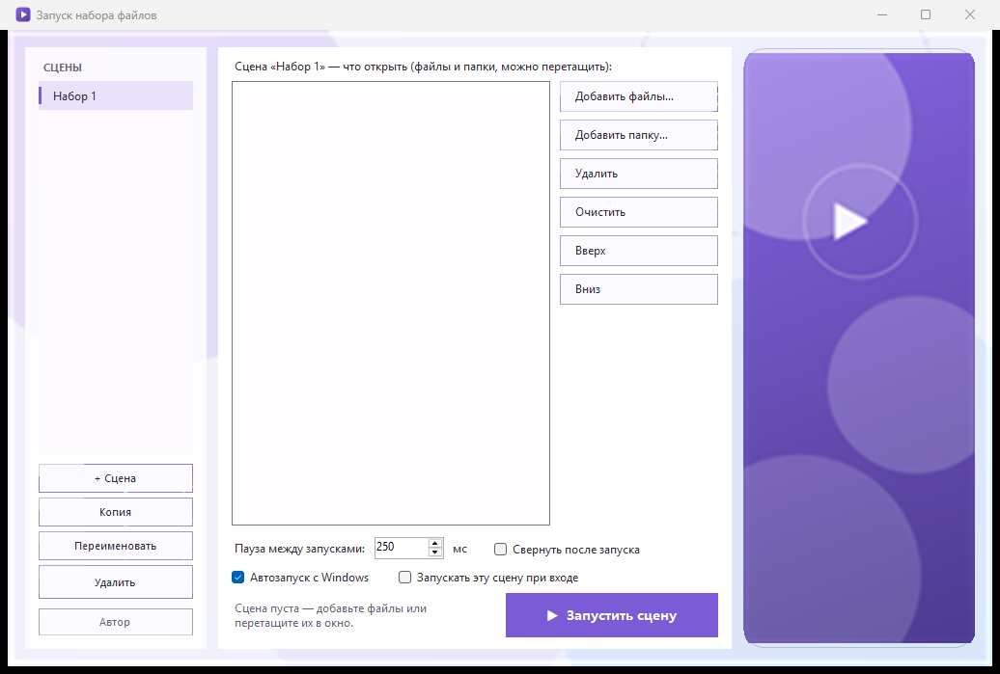

# FileLauncher — сцены запуска для Windows

Одна кнопка открывает сразу набор программ и документов. Наборы называются **сценами**
(как в OBS): переключаетесь между ними — у каждой свой список файлов. Программа умеет
жить в трее, автозапускаться с Windows и **открывать нужные сцены при входе** — у каждой
сцены своя галочка.



## Возможности

- **Сцены** — сколько угодно наборов файлов, переключение одним щелчком, переименование,
  копирование, удаление.
- **Запуск сцены** — все файлы открываются по порядку с настраиваемой паузой.
- **Своя автозагрузка у каждой сцены** — «Работа» стартует при входе, «Игры» нет.
  Сцены с меткой помечены точкой в списке.
- **Трей и фоновый режим** — крестик сворачивает в трей, оттуда можно запустить сцену.
- **Один экземпляр** — повторный запуск показывает уже работающее окно.
- Стандартный диалог выбора файлов Windows, drag & drop, порядок, контекстное меню.
- Только Windows Forms и .NET Framework 4.x — никаких сторонних библиотек.

## Скачать

Готовый `FileLauncher.exe` — в разделе **Releases** (файл в zip или отдельно).

Требования: Windows 7/10/11, .NET Framework 4.x (в Windows 10 1903+ и Windows 11 уже есть).
Установка не нужна — один exe. Работает на x86 и x64.

### Первый запуск

Файл не подписан цифровой подписью, поэтому Windows может показать
«Windows защитила ваш компьютер» → **«Подробнее» → «Выполнить в любом случае»**.
Если exe скачан браузером и вообще не запускается — правая кнопка → «Свойства» →
галочка **«Разблокировать»** → «ОК».

## Как пользоваться

1. Запустить `FileLauncher.exe`.
2. Слева — сцены. **«+ Сцена»** создаёт новый набор, **«Переименовать»** задаёт имя,
   **«Копия»** дублирует сцену вместе с файлами.
3. **«Добавить файлы…»** — выбрать файлы (Ctrl/Shift для нескольких) или перетащить их
   в список. **«Добавить папку…»** добавляет папку.
4. **«Запустить сцену»** — открыть всё по порядку. Пауза между запусками настраивается.
5. Галочка **«Запускать эту сцену при входе»** — при следующем входе в Windows открыть
   именно эту сцену. Можно отметить несколько сцен; `«Автозапуск с Windows»` включает
   саму программу в автозагрузке.

## Где хранятся данные

```
%APPDATA%\FileLauncher\scenes.txt    — сцены, файлы, флаг «запускать при входе»
%APPDATA%\FileLauncher\settings.txt  — активная сцена
```

Если `%APPDATA%` недоступен — файлы создаются рядом с программой. У каждого пользователя
свой набор сцен. Автозапуск пишется в `HKEY_CURRENT_USER\Software\Microsoft\Windows\
CurrentVersion\Run`, права администратора не нужны.

## Сборка из исходников

Visual Studio не требуется: компилятор C# входит в .NET Framework 4.x.

```bat
build.cmd
```

Скрипт собирает `FileLauncher.exe` из `src/FileLauncher.cs` и ресурсов в `assets/`.
На GitHub Actions сборка выполняется автоматически (`.github/workflows/build.yml`),
по тегу `v*` exe прикрепляется к релизу.

### Своё оформление

В `assets/` лежат нейтральные картинки (сгенерированы специально для этого репозитория,
CC0): фон окна, карточка-«портрет» справа и иконка. Их можно заменить своими — достаточно
сохранить те же имена файлов и пересобрать проект. Внутри exe подписи и авторства
изображений нет.

## Структура

```
src/FileLauncher.cs              исходник (один файл, WinForms)
assets/app.ico                   иконка
assets/background.png            фон окна
assets/hero.png                  картинка в правой колонке
docs/screenshot.png              скриншот
build.cmd                        сборка через csc.exe
.github/workflows/build.yml      CI: сборка и релиз
```

## Лицензия

[MIT](LICENSE) © 2026 silxncer

Автор проекта — [t.me/silxncer](https://t.me/silxncer)
